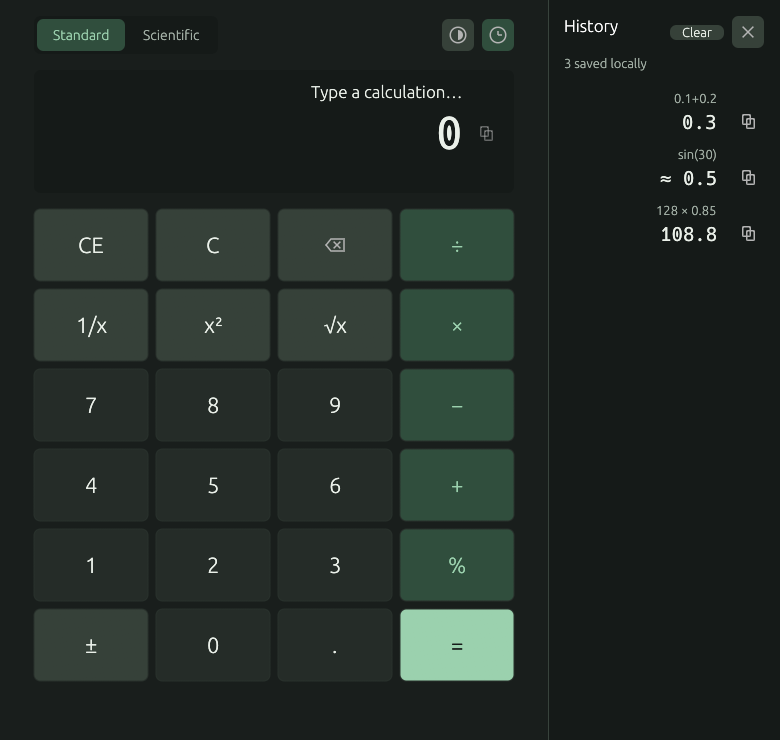

# Calculator

A quiet, keyboard-first desktop calculator, written in Rust. Warm neutrals, jade accents, a live result display, and a history rail that stays out of your way.



## Run

Install a current stable Rust toolchain, then:

```sh
cargo run --locked
cargo build --release --locked
```

The application display name is Calculator. The existing executable and application identifier are retained for compatibility. The executable is `target/release/cindral-calculator` (`.exe` on Windows). No browser, Node, JavaScript runtime, or webview is involved. Native window decorations provide platform window controls; text and controls scale with the display.

### Linux (initial development platform: Arch)

```sh
sudo pacman -S --needed base-devel rust libxkbcommon wayland libx11 libxcursor libxi libxrandr mesa
cargo build --release --locked
./target/release/cindral-calculator
```

Both Wayland and X11 backends are enabled. A working OpenGL driver is required (eframe's Glow renderer). On Debian/Ubuntu the corresponding development packages are `build-essential pkg-config libxkbcommon-dev libwayland-dev libx11-dev libxcursor-dev libxi-dev libxrandr-dev libgl1-mesa-dev`.

### Windows

Install Rust stable using rustup and the Visual Studio C++ build tools / Windows SDK. From a Developer PowerShell:

```powershell
cargo build --release --locked
.\target\release\cindral-calculator.exe
```

### macOS

Install the Xcode command-line tools (`xcode-select --install`) and Rust stable:

```sh
cargo build --release --locked
./target/release/cindral-calculator
```

Windows and macOS instructions and CI jobs are provided; neither platform has been tested locally. Build on each target OS for shipping. The included GitHub Actions workflow checks all three platforms when hosted in GitHub.

## Using Calculator

Type digits and arithmetic operators directly. Enter or `=` commits a calculation to history; Enter again repeats the top-level operation using its evaluated right-hand side. For example, `2+3*4` gives 14, then 26. Typing a digit after evaluation starts a new calculation; an operator continues with the result.

- `Backspace`: delete a character. `Escape`: close help or floating history first, otherwise clear all. `Delete`: clear the last operand outside the editor, or delete at the caret inside it.
- Click the expression to edit anywhere with a caret, selection, and standard undo/redo shortcuts. Function names such as `sin(30)` can be typed directly. After evaluation, typing at the end starts a new calculation (or continues from the result with an operator); click or navigate within the expression to correct it.
- `Ctrl+C` / `Ctrl+V`: copy the result / paste a number or expression (`Cmd` on macOS). Inside the expression editor these shortcuts copy the selection and paste at the caret. Outside the editor, pasted expressions are grouped as one operand.
- The display labels live previews, committed results, approximate results, and incomplete/error states. Invalid operations such as division by zero show their error during preview. A previous result is dimmed while the expression is incomplete or invalid, and cannot be copied. Status messages keep the keypad in place.
- `Ctrl+H` (also on macOS, preserving the system Cmd+H action): toggle history. `Ctrl+1` / `Ctrl+2`: Standard / Scientific mode. `F1`: shortcut reference, also available in the appearance menu.
- `Tab` / `Shift+Tab`: focus controls. `Space`: activate the focused control. Enter always evaluates.
- Standard mode includes reciprocal, square, square root, percent and sign change.
- Changing DEG/RAD recalculates the preview; press Enter to save it. Scientific mode adds powers, nth roots, trigonometry and inverse trigonometry, logs, factorials, π, e and parentheses. For an nth root, enter x, press `ʸ√x`, enter n, then `)`; this builds `x^(1/n)`. Square root and other unary buttons transform the last operand. On an empty operand, function buttons open a function for input.
- `^` is right-associative; exponentiation binds before unary minus: `-2^2 = -4`.
- Percentage is explicitly postfix division by 100: `200*10% = 20`; `200+10% = 200.1`; `200-10% = 199.9`; `50% = 0.5`; `0% = 0`. It does not infer a percentage of the left operand.
- Explicit scientific notation is supported, e.g. `1e-3`.
- History stores the latest 500 distinct consecutive calculations. Click an entry to restore its original editable expression and saved result, or use its copy icon. Recalled approximate results retain their approximation marker when used in further calculations. The history rail is resizable; below 720 logical points it opens in a floating panel. Escape dismisses the floating panel. Clearing history offers Undo.
- The compact appearance menu offers System, Light and Dark, plus keyboard shortcuts. System uses the OS theme reported by the window backend.

## Precision and limits

Ordinary arithmetic uses `rust_decimal`: a 96-bit coefficient with scale up to 28, roughly 28–29 significant digits depending on magnitude. Decimal input is parsed exactly; excess fractional precision is rejected. Operations use the library's checked decimal operations and its scale reduction/rounding behavior; nonterminating division is rounded to available decimal precision (nearest, ties to even). Zero-valued underflow in multiplication/division/powers reports an error. Overflow never silently switches ordinary arithmetic to floating point. Displayed decimal results are normalized without extra display rounding.

Scientific functions and noninteger powers use IEEE-754 `f64` and display up to 15 significant digits, marked `≈`. Scientific input outside decimal range also uses `f64`; nonfinite values and input underflow are rejected. Scientific arithmetic has normal IEEE-754 precision/underflow limitations. Scientific results copied or recalled use their displayed precision. Results from π/e are approximate. Factorials accept integers 0–170; 0–27 use exact decimal arithmetic. Invalid domains and division by zero are readable errors. Tangent rejects angles within a cosine tolerance of 1e-14 around singularities.

Expressions have a 2,048-byte, 256-operation and 64-parser-depth limit. History rows truncate long expressions and results, with full values in tooltips and exact values available through Copy. The result uses tabular numerals, scales to available width, and scrolls horizontally when necessary. The expression editor keeps native caret scrolling and selection. History rendering is bounded to 500 records.

## Storage and privacy

Preferences and history stay on this computer, using eframe's native local RON storage. Saved on normal exit and at a three-second autosave interval; an abrupt process termination may lose changes since the last save. The app has no network functionality or telemetry. Standard eframe paths are under the user's data directory (`~/.local/share/com.cindral.calculator` on Linux, the platform application-data directory on Windows and macOS). The exact directory is chosen by eframe using the application identifier. History can be cleared in the rail and restored with Undo during the current session. Restoring history preserves calculations made after clearing.

## Interface

The native window title is Calculator. A single toolbar groups the Standard/Scientific selector, appearance menu and active history toggle. The editable expression and result share a quiet display surface, with a copy icon beside the result and inline feedback. The idle display has no status label. Button surfaces distinguish digits, utility functions, scientific functions, operators and equals in both themes. A pending binary operator has an underline; keyboard focus has an inset ring, hover changes the surface, and pressing darkens it. Simple digits and arithmetic operators have no redundant tooltips. Toolbar and editing icons share a drawn stroke style and accessible names.

The default window is 480×680 logical points, with a 400×660 minimum. Calculator content is capped at 480 points wide and 780 tall, keeping keys comfortable in large windows. Scientific controls fit the same minimum window. History docks only when there is room for the calculator; a narrow window uses a floating panel. Existing preferences, history keys and application ID are unchanged.

## Architecture

- `src/calculator/`: parser, evaluation, decimal/scientific values and numerical tests; no GUI dependency.
- `src/app.rs`: editing state, preview/commit lifecycle, repeat operation and clipboard actions.
- `src/input.rs`: keyboard event translation.
- `src/ui/`: custom components, palettes, responsive layout, history and shortcut reference.
- `src/history.rs`: bounded serializable records.
- `src/settings.rs`: serializable appearance, mode and angle preferences.

GUI evaluation: egui/eframe was chosen for its portable Rust implementation, custom drawing/styling and low integration overhead. Iced offers a useful message-driven architecture; Slint offers declarative UI with separate syntax and licensing choices; GPUI merits additional platform integration evaluation. The UI uses native window controls and accessible egui buttons with AccessKit enabled. Screen-reader behavior still needs manual verification on each OS.

## Quality checks

```sh
cargo fmt --check
cargo clippy --all-targets --locked -- -D warnings
cargo test --locked
```

See [PROGRESS.md](PROGRESS.md) for actual local validation and known limits. See [packaging/README.md](packaging/README.md) for installation/distribution guidance.

MIT licensed.

Typography uses eframe's bundled fonts with DejaVu Sans as a mathematical-symbol fallback. Its license is in `assets/DejaVuSans-LICENSE.txt`.
